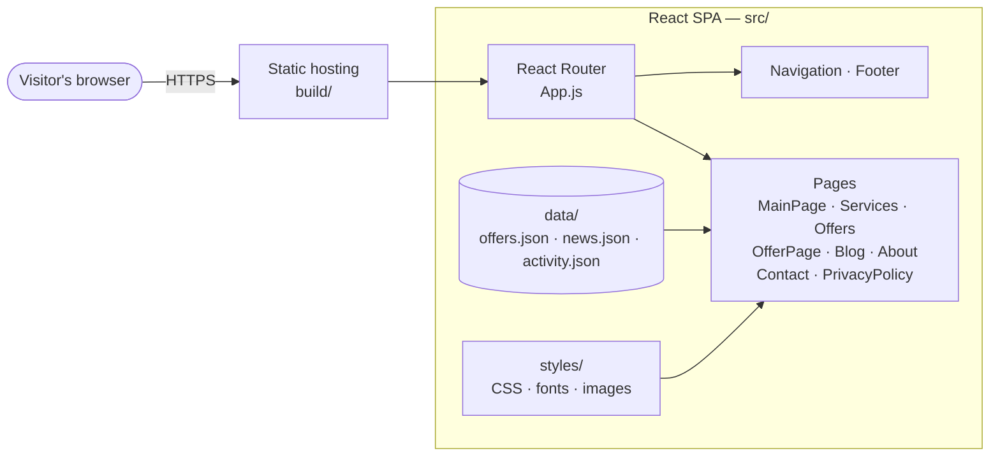
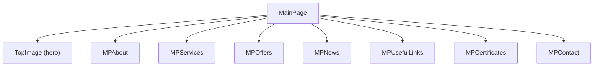

# aKowerczykApp

A single page website for a real estate company. Visitors can browse property offers, read about the company's services, check news and certificates, and contact the company.

## Features

- Home page assembled from sections: about, services, offers, news, useful links, certificates and contact
- Property offers list and a dedicated page for every offer (`/offer/:id`)
- Services page
- Blog / news section
- About page and company certificates
- Contact page with a contact form
- Privacy policy page
- Sticky navigation with smooth in-page scrolling (`react-router-hash-link`)
- Responsive layout (Bootstrap 5)
- Content stored in JSON files, easy to update without changing the components

## Architecture

The app is a client-side React single page application. There is no backend in this repository: routing is handled in the browser and the content comes from static JSON files bundled with the app.



### Routes

| Route | Component | Description |
|-------|-----------|-------------|
| `/` | `MainPage` | Landing page with all sections |
| `/services` | `Services` | Company services |
| `/offers` | `Offers` | List of property offers |
| `/offer/:id` | `OfferPage` | Details of a single offer |
| `/blog` | `Blog` | News and articles |
| `/about` | `About` | About the company |
| `/contact` | `Contact` | Contact details and form |
| `/privacy-policy` | `PrivacyPolicy` | Privacy policy |

A social media activity section (`/socialactivity`, `/socialactivity/:id`) is implemented but currently disabled in `App.js`.

### Home page composition



## Tech stack

| Layer | Technology |
|-------|------------|
| Framework | React 18 (Create React App) |
| Routing | React Router 6, react-router-hash-link |
| UI | Bootstrap 5, reactstrap, custom CSS |
| Icons | Font Awesome (free solid and brands) |
| Testing | React Testing Library, Jest |
| Package manager | Yarn |

## Project structure

```
aKowerczykApp/
├── public/
├── src/
│   ├── components/
│   │   ├── Navigation.js, Footer.js, TopImage.js
│   │   ├── MainPage.js
│   │   ├── MPAbout.js, MPServices.js, MPOffers.js, MPNews.js,
│   │   │   MPUsefulLinks.js, MPCertificates.js, MPContact.js   # home page sections
│   │   ├── Services.js, Service.js
│   │   ├── Offers.js, Offer.js, OfferPage.js
│   │   ├── Blog.js, News.js, NewsBlog.js
│   │   ├── About.js, Certifacates.js
│   │   ├── Contact.js, ContactForm.js
│   │   ├── PrivacyPolicy.js
│   │   └── SocialActivity.js, SocialMedia.js, Activity.js        # currently disabled
│   ├── data/                # offers.json, news.json, activity.json
│   ├── styles/              # one CSS file per view, fonts, images
│   ├── App.js               # layout and routes
│   └── index.js
├── package.json
└── yarn.lock
```

## Getting started

### Prerequisites

- Node.js 16+ 
- Yarn

### Install and run

```bash
git clone https://github.com/GaussFighting/aKowerczykApp.git
cd aKowerczykApp
yarn install
yarn start
```

The app opens at `http://localhost:3000`.

### Build

```bash
yarn build
```

The production build is created in the `build/` folder and can be deployed to any static hosting (Netlify, GitHub Pages, ...). Because the app uses client-side routing, configure the host to redirect all paths to `index.html`.

### Tests

```bash
yarn test
```

## Updating content

- **Offers:** edit `src/data/offers.json` (each offer needs a unique `id` used in `/offer/:id`)
- **News / blog:** edit `src/data/news.json`
- **Images and fonts:** `src/styles/images`, `src/styles/fonts`

## Roadmap

- [ ] Enable the social media activity section
- [ ] Offer filtering and search
- [ ] SEO: page titles, meta tags, sitemap
- [ ] Connect offers to an API or CMS instead of JSON files

